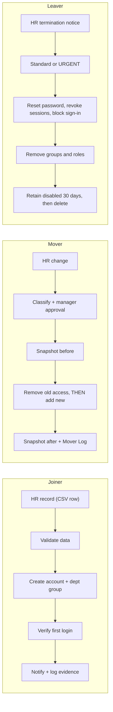

# Project 1: User Lifecycle Management (Joiner / Mover / Leaver)

A hands-on identity lifecycle lab in **Microsoft Entra ID (Free)**: 15 fake users provisioned from a CSV that stands in for an HR system, moved between roles, and offboarded, with a runbook, controls mapping, metrics, and audit-log evidence for each case.

**What this demonstrates:** bulk provisioning, group-based birthright access, mover handling (remove-before-add), urgent offboarding, audit evidence, and an honest review of where my own execution deviated from my runbook.

## Lab environment
- Entra ID Free tenant (Azure free account), 15 lab users + the tenant admin (16 listed).
- `data/hr-source.csv` is the source of truth; `data/users.sample.csv` is the Entra bulk-create format generated from it (passwords and tenant domain removed).
- Groups: `grp-sales`, `grp-hr`, `grp-it`, `grp-finance`, `grp-contractors`.

## Process design
Full detail in [`docs/jml-runbook.md`](docs/jml-runbook.md); naming and access decisions in [`docs/design-standards.md`](docs/design-standards.md); editable diagram in [`docs/jml-flow.drawio`](docs/jml-flow.drawio).



## Scenarios executed and results

| Scenario | User | What was done | Evidence |
|---|---|---|---|
| Joiner (bulk) | 15 users | Bulk-created from CSV in Entra | [users list](evidence/01-joiner/users-list.png) |
| Joiner (first login) | Ethan Walker | Forced password change confirmed at first sign-in | [screenshot](evidence/01-joiner/first-login-forced-password-change.png) |
| Joiner (group assignment) | Whole batch | Department group membership imported from CSV; operation succeeded | [bulk operation result](evidence/01-joiner/group-import-bulk-operation.png) |
| Mover, cross-department | Diego Torres | Sales → Finance: removed from `grp-sales`, added to `grp-finance`, profile and manager updated | [before](evidence/02-mover/diego-before-groups.png), [after](evidence/02-mover/diego-after-groups.png), [audit log](evidence/02-mover/diego-audit-log.png) |
| Mover, privilege increase | Maya Patel | IT Helpdesk Analyst → Systems Administrator; directory roles assigned (see Finding 1) | [before](evidence/02-mover/maya-before-profile.png), [after](evidence/02-mover/maya-after-profile.png), [roles on daily account](evidence/02-mover/maya-assigned-directory-roles.png), [roles on admin account](evidence/02-mover/maya-adm-assigned-directory-roles.png), [daily account after remediation](evidence/02-mover/maya-daily-account-roles-after-remediation.png), [audit log](evidence/02-mover/maya-audit-log.png) |
| Mover, title only | Priya Nair | Account Executive → Senior Account Executive (profile change only) | [before](evidence/02-mover/priya-before-profile.png), [after](evidence/02-mover/priya-after-profile.png) |
| Leaver, urgent | Hannah Brooks (Contractor) | Password reset, sessions revoked, account disabled, groups removed | [audit log](evidence/03-leaver/hannah-urgent-leaver-audit-log.png) |
| Leaver, standard | Tyler Nguyen | Password reset, sessions revoked, account disabled, group removed; account retained disabled | [notice and record](evidence/03-leaver/tyler-leaver-notice.md), [audit log](evidence/03-leaver/tyler-audit-log.png), [before](evidence/03-leaver/tyler-overview-before.png), [after](evidence/03-leaver/tyler-overview-after.png) |
| Retention test (soft delete and restore) | Lena Fischer (Contractor) | Deleted, then restored. Deleted users page shows a permanent-deletion date 30 days out; audit log shows the restore; her groups (`grp-it`, `grp-contractors`) reappeared without being re-added | [deleted users page](evidence/03-leaver/deleted-users-retention-window.png), [audit log](evidence/03-leaver/lena-restore-audit-log.png), [groups after restore](evidence/03-leaver/lena-groups-after-restore.png) |


## What the audit logs show (local time; 10/19/2026 unless noted)

| Case | Sequence from audit log | Elapsed |
|---|---|---|
| Diego (mover) | 12:30:51 removed from group → 12:31:04 added to group → 12:34:24 profile + manager updated | Remove → add: 13 s. Group change → attribute update: 3 min 33 s |
| Maya (mover) | 12:43:35 profile updated → 12:47:55 four "Add member to role" events | 4 min 20 s |
| Hannah (urgent leaver) | 2:10:12 password reset → 2:10:26 sessions revoked → 2:10:40 account disabled → 2:13:31 two group removals | First action → disabled: 28 s. First action → fully removed: 3 min 19 s |
| Tyler (standard leaver, 10/26) | 1:05:32 password reset → 1:05:39 sessions revoked → 1:05:59 account disabled → 1:06:30 group removed | First action → disabled: 27 s. First action → fully removed: 58 s |
| Lena (restore test, 10/20) | 12:26:26 user deleted → 12:28:25 user restored | 1 min 59 s; groups restored with the account |
| Joiners (10/15) | Tyler's account created 3:40 PM → group membership import 3:46 PM | About 6 min from account creation to birthright access |

Diego's log confirms **remove-before-add**. These are execution times only: the lab has no HR notice timestamp, so true time-to-deprovision from notice is not measured.

## Findings and lessons learned

1. **Over-privileged mover (remediated).** Maya's original audit log and roles page show four directory roles assigned directly to her daily account at once, including Privileged Role Administrator (which can grant any role, up to Global Administrator), plus Helpdesk Administrator, Intune Administrator, and User Administrator. This broke my own runbook, which requires a justification and a separate admin account. **Remediation:** I created a separate admin account, `adm-maya.patel` (shown as "Maya Patel (adm)"), with Helpdesk Administrator and User Administrator ([evidence](evidence/02-mover/maya-adm-assigned-directory-roles.png)), matching the `adm-` naming standard, and removed all directory roles from her daily account ([evidence](evidence/02-mover/maya-daily-account-roles-after-remediation.png), "No directory roles assigned"). **Remaining gap:** the admin assignments are still permanent; just-in-time activation (Entra PIM) needs a paid license tier. Lesson: a title change is not a reason to grant every admin role, and least privilege has to be applied to directory roles, not just groups.
2. **Runbook order was not executable (runbook corrected).** My first draft said to disable the account first. When I ran the urgent leaver, Entra refused to reset the password of a disabled account, so the working order was reset password (2:10:12), revoke sessions (2:10:26), then disable (2:10:40), 28 seconds from start to disable. The order is defensible: the reset closes the password path, the revocation closes existing sessions, and the disable closes everything else, with no one holding the new password. The trade-off is a short window in which the account is still enabled, so the steps must run back to back. Lesson: I wrote the runbook from theory, and executing it found a platform constraint. I updated the runbook to the tested order.
3. **Group change preceded the attribute update.** Diego's group membership changed about 3.5 minutes before his department/manager attributes did, leaving a window where the two disagreed. With attribute-driven dynamic groups (Entra ID P1) this window disappears, because membership follows the attribute. Lesson: update the source attribute first, or make the change in one step.
4. **Restoring a user brings access back.** After I restored Lena Fischer (deleted 12:26:26, restored 12:28:25), she was again a member of `grp-it` and `grp-contractors` without anyone re-adding her. Soft delete is a safety net for mistakes, but it also means a restored account regains group access immediately. A restore returns whatever memberships existed at deletion, so removing groups before deleting (as the runbook does) limits what comes back. Lesson: restores should require approval and an immediate access re-review.

## Known gaps and production fixes

| Gap | Production fix |
|---|---|
| Manual CSV instead of an HR integration | HR system as authoritative source, feeding Entra through provisioning/SCIM, with reconciliation reports |
| Static groups and manual membership | Dynamic groups from `department`/`jobTitle` plus scheduled access reviews (script automation planned in Project 5) |
| No app-level accounts, short log retention | Apps behind SSO or SCIM, logs shipped to a SIEM, inventory of apps with local accounts |
| Scheduled leaver not automated: I could not configure native scheduling in the free tier, so offboarding is run manually | Scheduling driven by the HR leave date; in this lab, a script reading `EndDate` from the CSV (Project 5) |

## Repository layout
```
p1-lifecycle/
├── README.md
├── data/        hr-source.csv, users.sample.csv
├── docs/        jml-runbook.md, design-standards.md, jml-flow.drawio
└── evidence/    01-joiner/, 02-mover/, 03-leaver/
```

## Data handling
All users are fictional. The real upload file (`data/users.csv`) contained temporary passwords and the tenant domain, so it is git-ignored and not published. Screenshots were redacted to hide sensitive data.

## Next steps
Project 2 (RBAC) maps these groups to real resources, and Project 5 automates the joiner, mover, and leaver steps with the Okta API.
